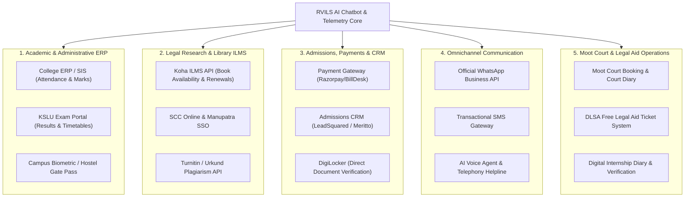

# MKPM RV Institute of Legal Studies (RVILS)
## Chatbot Implementation Audit & Institutional Integration Proposal

> **Document Type:** Institutional Executive Briefing & Technical Proposal  
> **Prepared For:** Principal, Board of Management, Governing Council & IT/Admissions Committee  
> **Affiliation:** Karnataka State Law University (KSLU), Hubballi | Bar Council of India (BCI)  
> **Governing Trust:** Rashtreeya Sikshana Samithi Trust (RSST), Bengaluru  

---

## Part 1: Implemented Data & Features (Audit for Institutional Permission)

The following data points, knowledge repositories, and functional features are **currently implemented** in the live RVILS Chatbot. All content is derived **strictly from the official portal (`rvils.edu.in`)** with zero third-party extrapolation or cloud AI hallucinations.

### 1. Institutional Governance & Affiliations
* **Legal Identity:** MKPM RV Institute of Legal Studies (established 2018).
* **Trust:** Rashtreeya Sikshana Samithi Trust (RSST, est. 1940) led by **Dr. M.P. Shyam** (President, RSST/RVEI) and **Sri N.R. Nandish** (Chairman, Governing Council).
* **Statutory Recognitions:**
  * Affiliated to **Karnataka State Law University (KSLU)**, Hubballi.
  * Approved by the **Bar Council of India (BCI)**, New Delhi.
* **Campus Details:** #45/1, 22nd Cross, 3rd Block, Jayanagar, Bengaluru – 560011; Contact: `+91-80-69018952/53`, `rvils@rvei.edu.in`.
* **RVCE vs RVILS Disambiguation:** Clear boundary rules explaining that RVILS exclusively confers law degrees, while directing engineering inquiries to `rvce.edu.in` and clarifying 3-Year LL.B. eligibility for engineering graduates.

### 2. Academic Programmes & Curricula
Detailed syllabi, semesters, specializations, and career avenues for all 4 approved programmes:
* **5-Year Integrated B.A. LL.B. (10 Semesters):** Political Science, Sociology, Economics, Constitutional Law, Criminal Jurisprudence; tailored for Judiciary, UPSC, and Appellate Advocacy.
* **5-Year Integrated B.B.A. LL.B. (10 Semesters):** Strategic Management, Corporate Governance, Corporate Laws, M&A, IPR, Commercial Arbitration; tailored for Tier-1/Tier-2 Law Firms and Corporate Legal Counsel.
* **5-Year Integrated B.Com. LL.B. (10 Semesters):** Financial Accounting, Corporate Auditing, Indirect Tax (GST), Direct Tax Codes, Banking Law, IBC; tailored for Corporate Tax Advisory, NCLT, and Big 4 firms.
* **3-Year LL.B. for Graduates (6 Semesters):** Professional postgraduate law degree open to holders of any Bachelor’s degree (B.A., B.Sc., B.Com., B.B.A., B.E./B.Tech); procedural laws, drafting, and chamber attachments.

### 3. Admissions Lifecycle & Statutory KSLU Eligibility
* **6-Step Selection Flow:** Application Submission $\rightarrow$ RVILS-LAT Entrance Test $\rightarrow$ Institutional Interaction $\rightarrow$ Personal Interview $\rightarrow$ Offer of Admission $\rightarrow$ Document Verification.
* **Statutory Minimum Aggregate Cut-offs (KSLU/BCI Norms):**
  * **General Merit (GM):** Minimum **45%** in 10+2 / PUC / Degree.
  * **OBC Categories:** Minimum **42%** aggregate.
  * **SC / ST / Category-I:** Minimum **40%** aggregate.
* **RVILS-LAT (Law Aptitude Test):** 100-mark test covering Legal Reasoning, General Knowledge & Current Affairs, Analytical Ability, and English.

### 4. Faculty & Leadership Directory
* **Founder Principal:** Prof. (Dr.) Anjina Reddy K.R. *(B.A.L., LL.M., M.Phil., Ph.D.)*.
* **Core Faculty:** Dr. Hanumaprakash K.S. (Commercial Law), Dr. Thejesh B.S. (Management), Mr. Aswin K. (Corporate Law), Mrs. Chaitra P. (Constitutional Law), Mrs. Runjhun Ray (International Law), Mrs. Anncy P. (Criminal Law), Mrs. Shruthi B.A. (Economics), Mr. Rahul Simha (Constitutional Law), Mrs. Sheena P.R. (Family Law), Mrs. Kruthika H.R. (Cyber Law/IPR), and Mrs. Paavana (Social Sciences).
* **Physical Education & Sports:** Mr. Mohan Kumar N.N. (Director of Physical Education, Commonwealth Kabaddi champion).
* **Library Administration:** Mr. Santosh Kumar Naragund (Librarian).

### 5. Campus Facilities & Clinical Practicals
* **Moot Court Hall:** Dedicated High-Court bench replica hall for simulated appellate advocacy, memorial drafting, and national trials.
* **RVILS Legal Services Clinic:** Free legal consultations (Monday–Friday 10:00 AM – 4:00 PM), District Legal Services Authority (DLSA) collaborations, and rural legal literacy field surveys (e.g. Thattaguppe village).
* **National & State Lok Adalat:** Participatory dispute resolution training under the Legal Services Authorities Act, 1987.
* **Hybrid Library:** 15,000+ law volumes, Koha ILMS, SCC Online, Manupatra digital databases, and the calligraphed **Original Constitution Manuscript** replica.
* **Campus Life:** Separate hostels for boys & girls, cafeteria, indoor/outdoor sports, anti-ragging squad, ICC, and SC/ST Equal Opportunity cell.

### 6. Specialized Legal Education Modules
* **Interactive Legal Stream Matcher:** A 2-step guided quiz recommending optimal degree streams based on educational background and career goals.
* **BCI Mandatory 20-Week Clinical Internship Roadmap:** Phase 1 (NGOs & Rural Surveys) $\rightarrow$ Phase 2 (Trial Courts) $\rightarrow$ Phase 3 (Appellate Courts) $\rightarrow$ Phase 4 (DLSA, Law Firms, Corporate Desks).
* **Latin Maxims & Courtroom Glossary:** Definitions and courtroom contexts for *Pro Bono Publico*, *Audi Alteram Partem*, *Amicus Curiae*, *Suo Motu*, *Locus Standi*, *Habeas Corpus*, *Res Judicata*, *Ultra Vires*, *Caveat Emptor*, *De Minimis*, and *Lok Adalat*.

### 7. Research & Publications Suite
* **RV Law Journal (ISSN: 2583-5041):** Biannual blind peer-reviewed journal, OSCOLA citation format, volumes 3 to 5 (2024–2026), submission email: `rvlawjournal.mkpmrvils@rvei.edu.in`.
* **Samarthana:** Annual college magazine featuring student/faculty legal reflections (Volumes 2018–2025).
* **RVILS Newsletter:** Bi-annual documentation of moots, guest lectures, and campus achievements (latest: July 2025 – January 2026).
* **Books & ISBN Volumes:** Centre for Research and Publication (CRP) publications.
* **Seminars & Conferences:** *Role of Evidence in Criminal Justice* (DGP Kamal Pant & AIIMS Prof. Dinesh Rao), *Bharatiya Nyaya Sanhita* seminar (Senior Standing Counsel Madhukar Deshpande).
* **Global Collaborations:** **University of Leeds (UK)** lecture on International Criminal Law by Dr. Ilaria Zavoli, Kaale & Kaale corporate practice, DLSA Bengaluru Urban, B.PAC.

---

## Part 2: Possible Future Integrations (To Propose to the Institute)

The following modular integrations can be proposed to the RVILS leadership to elevate the platform from a conversational assistant into a full-scale institutional digital hub:

### 1. Academic & Campus Administration (ERP / SIS)
* **College ERP / Student Information System Integration:**
  * *Capability:* Students authenticate with their Roll Number / USN to check internal attendance percentages, internal test marks, hall ticket release dates, and pending tuition dues.
  * *Supported ERPs:* Contineo, Dhi, Linways, Jenzabar, or custom RSST ERP.
* **KSLU Examination & Circulars API:**
  * *Capability:* Automated real-time alerts when Karnataka State Law University publishes revaluation dates, exam timetables, or semester results.
* **Hostel & Gate Pass Verification:**
  * *Capability:* Hostel wardens and students can check curfew timings, submit digital leave applications, and notify parents.

### 2. Library & Legal Research Systems
* **Koha Open-Source ILMS API:**
  * *Capability:* Students can query the chatbot for book availability in the RVILS Hybrid Library (e.g., *"Is Mulla on Hindu Law available?"*), view book locations (Rack/Row), and renew issued books directly in chat.
* **SCC Online & Manupatra Single Sign-On (SSO):**
  * *Capability:* Instant authentication handoff from chatbot queries directly into remote digital database accounts.
* **Turnitin / Urkund Pre-Submission API:**
  * *Capability:* Automated similarity index checking for student moot court memorials and *RV Law Journal* paper submissions.

### 3. Admissions, Fee Payments & Lead CRM
* **Payment Gateway Integration (Razorpay / BillDesk / Cashfree):**
  * *Capability:* Instant collection of **RVILS-LAT application fees (e.g. ₹500 - ₹1,000)**, prospectus fees, or admission reservation deposits directly through conversational UPI/Credit Card links with automated PDF receipts.
* **Admissions CRM Integration (LeadSquared / Meritto / Salesforce):**
  * *Capability:* Leads collected by the chatbot instantly sync into the admissions counselor dashboard, assign follow-up tasks, and calculate lead engagement scores.
* **DigiLocker Instant Academic Verification:**
  * *Capability:* Seamless document upload during admission where applicants pull verified 10th/12th/Graduation mark sheets and caste certificates directly from DigiLocker without manual scanning.

### 4. Omnichannel Student & Parent Communication
* **Official WhatsApp Business API (Green Tick Verified):**
  * *Capability:* Deploying the exact same verified NLP knowledge base onto an official WhatsApp number (+91-80-69018952), allowing prospective students and parents across India to inquire on WhatsApp.
* **Transactional SMS Gateway (DND Compliant):**
  * *Capability:* Sending OTP verification during enquiry submission and dispatching emergency holiday / circular alerts.
* **Interactive AI Voice Agent (IVR Telephony):**
  * *Capability:* Connecting the chatbot engine to the main phone lines to handle inbound phone calls in English, Kannada, and Hindi.

### 5. Moot Court & Clinical Advocacy Operations
* **Court Diary & Moot Court Hall Scheduler:**
  * *Capability:* Digital slot booking for student teams preparing for national moot court competitions with judge feedback capture.
* **DLSA & Legal Services Clinic Grievance Portal:**
  * *Capability:* Enabling local citizens in Bengaluru to book free legal consultation slots with clinic faculty and student para-legal volunteers.
* **Digital 20-Week BCI Internship Diary:**
  * *Capability:* Online daily work log submission with digital advocate verification to streamline Bar Council compliance.

---

## Part 3: Executive Permission Request Checklist

When presenting this proposal to the RVILS leadership, the following approval checklist can be reviewed:

1. [ ] **Website Data Verification:** Authorization to display all current academic, leadership, and publication details extracted from `rvils.edu.in`.
2. [ ] **Admissions Contact Routing:** Confirmation of recipient email addresses for candidate enquiries submitted via the chatbot enquiry form.
3. [ ] **WordPress Plugin Installation:** Authorization to deploy `rvils-chatbot.zip` into the production WordPress environment.
4. [ ] **Telemetry Hosting Approval:** Decision on whether to utilize the internal WordPress database or the standalone Central Command Center on cloud infrastructure.
5. [ ] **Phase-2 Integration Priority:** Selection of top 2 priority integrations from Part 2 (e.g., WhatsApp Business API and Razorpay Payment Gateway).

